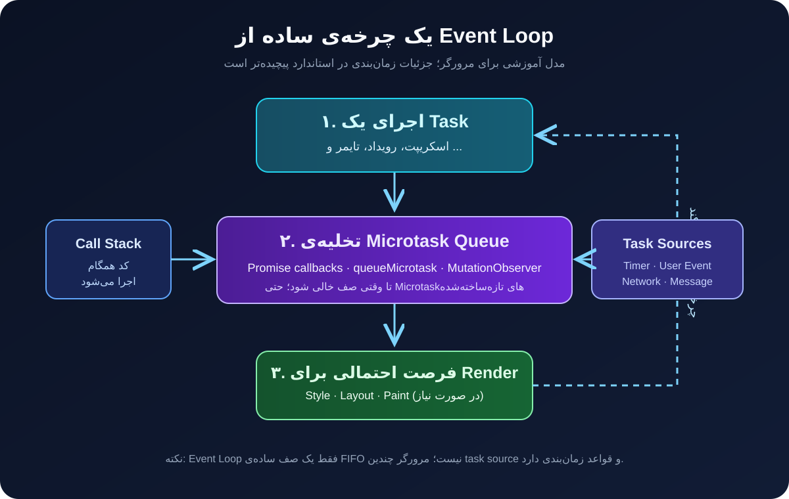

# JavaScript Event Loop؛ جاوااسکریپت دقیقاً چطور کارهای ناهمگام را اجرا می‌کند؟

احتمالاً این کد را دیده‌ای:

```js
console.log("اول");

setTimeout(() => {
  console.log("دوم");
}, 0);

Promise.resolve().then(() => {
  console.log("سوم");
});

console.log("چهارم");
```

خروجی چیست؟

```text
اول
چهارم
سوم
دوم
```

شاید در نگاه اول عجیب باشد. مگر زمان `setTimeout` صفر نیست؟ پس چرا callback آن زودتر اجرا نمی‌شود؟ چرا Promise قبل از تایمر اجرا می‌شود؟ و مهم‌تر از همه، وقتی جاوااسکریپت روی یک thread اجرا می‌شود، چطور می‌تواند هم‌زمان منتظر پاسخ شبکه بماند و به کلیک کاربر هم واکنش نشان دهد؟

پاسخ این سؤال‌ها در مفهومی به نام **Event Loop** قرار دارد.

در این مقاله مدل اجرای جاوااسکریپت در مرورگر را از پایه می‌سازیم، سپس با مثال‌های کوچک ترتیب اجرای کد را پیش‌بینی می‌کنیم. هدف حفظ کردن چند قانون پراکنده نیست؛ می‌خواهیم بتوانیم دلیل خروجی هر قطعه کد را توضیح دهیم.

> **محدوده‌ی مقاله:** تمرکز این مطلب روی محیط مرورگر و HTML Event Loop است. محیط Node.js نیز Event Loop دارد، اما جزئیات زمان‌بندی و فازهای آن با مرورگر یکسان نیست.

## ۱. اول یک سوءتفاهم را برطرف کنیم: جاوااسکریپت و ناهمگامی

در یک اجرای معمولی روی main thread، کد JavaScript به‌صورت ترتیبی اجرا می‌شود. در هر لحظه، یک قطعه کد روی آن thread در حال اجراست. این ویژگی به معنی آن نیست که کل مرورگر فقط یک thread دارد یا همه عملیات‌ها را خود موتور JavaScript انجام می‌دهد.

مرورگر امکاناتی مانند تایمر، شبکه، ورودی کاربر و Web APIها را در اختیار کد قرار می‌دهد. وقتی مثلاً `fetch()` را صدا می‌زنیم، لازم نیست thread جاوااسکریپت تا دریافت پاسخ متوقف بماند. مرورگر عملیات شبکه را مدیریت می‌کند و وقتی نتیجه آماده شد، ادامه‌ی کار را از طریق سازوکار Promise و صف‌بندی callbackها به زمان مناسب موکول می‌کند.

پس این دو گزاره را با هم اشتباه نگیریم:

- **JavaScript روی یک thread اجرا می‌شود:** در یک agent معمولی، اجرای کد روی همان thread به‌صورت هم‌زمان و موازی انجام نمی‌شود.
- **مرورگر فقط یک thread دارد:** نادرست است. مرورگر می‌تواند برای شبکه، رندر، ورودی و workerها از threadها و سازوکارهای دیگری استفاده کند.

Event Loop هماهنگ‌کننده‌ی اجرای کارهای آماده در یک agent است؛ نه جادویی که کد JavaScript را واقعاً هم‌زمان اجرا کند.

## ۲. چهار قطعه‌ی اصلی مدل اجرا

برای فهم Event Loop ابتدا باید چند اصطلاح را بشناسیم.

### Call Stack؛ پشته‌ی فراخوانی

هر بار تابعی اجرا می‌شود، یک Execution Context برای آن ایجاد و روی Call Stack قرار می‌گیرد. با تمام شدن تابع، context آن از stack خارج می‌شود.

```js
function first() {
  second();
  console.log("first");
}

function second() {
  console.log("second");
}

first();
```

ترتیب خروجی:

```text
second
first
```

در زمان اجرای `second()`، تابع `first()` هنوز روی stack قرار دارد. تابع داخلی باید تمام شود تا اجرای تابع بیرونی ادامه پیدا کند.

می‌توان وضعیت stack را به‌صورت ساده این‌طور دید:

```text
شروع اجرای first:
| first  |

هنگام اجرای second:
| second |
| first  |

بعد از پایان second:
| first  |

بعد از پایان first:
|        |
```

این رفتار همان اصل LIFO است: آخرین چیزی که وارد stack شده، اولین چیزی است که خارج می‌شود.

### Web APIs و محیط میزبان

`setTimeout`، `fetch` و event listenerها قابلیت‌هایی هستند که محیط میزبان، مثلاً مرورگر، در اختیار JavaScript قرار می‌دهد. این قابلیت‌ها جزو خود زبان ECMAScript به معنای دقیق کلمه نیستند.

برای مثال:

```js
console.log("شروع");

setTimeout(() => {
  console.log("تایمر تمام شد");
}, 1000);

console.log("پایان");
```

مرورگر زمان‌بندی تایمر را مدیریت می‌کند. اجرای تابع فعلی منتظر یک ثانیه نمی‌ماند و بلافاصله به خط بعد می‌رود.

نکته‌ی مهم: تمام شدن زمان تایمر به معنی اجرای فوری callback نیست. فقط یعنی callback واجد شرایط قرار گرفتن در صف اجرای یک Task شده است؛ اجرای واقعی آن باید منتظر خالی شدن stack و نوبت مناسب Event Loop بماند.

### Task؛ کارهای صف‌بندی‌شده

در مدل مرورگر، کارهایی مانند اجرای اسکریپت اولیه، callback یک رویداد کاربر و callback تایمر می‌توانند به‌صورت Task زمان‌بندی شوند.

نمونه‌ها:

- اجرای یک script
- پاسخ به کلیک کاربر
- callback مربوط به `setTimeout`
- برخی callbackهای پیام‌رسانی

به Taskها گاهی در آموزش‌های قدیمی‌تر Macrotask هم گفته می‌شود؛ اما اصطلاح دقیق‌تر در استاندارد HTML همان Task است.

یک نکته‌ی ظریف: مرورگر الزاماً فقط یک صف ساده برای همه Taskها ندارد. استاندارد از Task Sourceهای مختلف صحبت می‌کند و انتخاب Task بعدی تابع قواعد زمان‌بندی مرورگر است. بنابراین مدل «یک صف بزرگ FIFO» برای شروع مفید است، ولی تمام واقعیت نیست.

### Microtask؛ کارهای کوچک با اولویت زمانی بالاتر

Microtaskها بعد از پایان اجرای کد فعلی و خالی شدن stack، در یک checkpoint اجرا می‌شوند. در مرورگر، callbackهای Promise و `queueMicrotask()` از نمونه‌های مهم Microtask هستند. MutationObserver نیز از همین سازوکار استفاده می‌کند.

```js
console.log("A");

queueMicrotask(() => {
  console.log("B");
});

console.log("C");
```

خروجی:

```text
A
C
B
```

چرا؟ چون کد همگام ابتدا کامل می‌شود. سپس وقتی stack خالی شد، Microtask اجرا می‌شود.

**قاعده‌ی مهم:** در یک Microtask checkpoint، مرورگر صف Microtask را تا خالی شدن کامل تخلیه می‌کند. اگر یک Microtask، Microtask دیگری بسازد، آن کار جدید هم پیش از رفتن سراغ Task بعدی اجرا خواهد شد.

## ۳. چرخه‌ی Event Loop چگونه پیش می‌رود؟

مدل ذهنی ساده برای مرورگر این است:

1. یک Task انتخاب و اجرا می‌شود.
2. پس از پایان اجرای آن و خالی شدن stack، Microtask checkpoint انجام می‌شود.
3. Microtaskها تا خالی شدن صف اجرا می‌شوند.
4. مرورگر در زمان مناسب می‌تواند فرصت به‌روزرسانی Rendering را داشته باشد.
5. چرخه ادامه پیدا می‌کند و Task بعدی انتخاب می‌شود.

این نمودار یک تصویر آموزشی از همین روند است:



توجه کن که مرحله‌ی Rendering در هر دور الزاماً اجرا نمی‌شود. مرورگر با توجه به نیاز و زمان‌بندی فریم تصمیم می‌گیرد چه زمانی Style، Layout و Paint را به‌روزرسانی کند. همچنین جزئیات واقعی Event Loop از این نمودار ساده پیچیده‌تر است.

## ۴. چرا Promise قبل از setTimeout اجرا می‌شود؟

به مثال اول برگردیم:

```js
console.log("اول");

setTimeout(() => {
  console.log("دوم");
}, 0);

Promise.resolve().then(() => {
  console.log("سوم");
});

console.log("چهارم");
```

گام به گام:

**گام اول:** اسکریپت اصلی خودش یک Task است. بنابراین دو `console.log` همگام اجرا می‌شوند:

```text
اول
چهارم
```

**گام دوم:** callback مربوط به `setTimeout` برای یک Task در آینده زمان‌بندی می‌شود. مقدار صفر به معنی اجرای فوری نیست.

**گام سوم:** callback مربوط به `.then()` به صف Microtask اضافه می‌شود.

**گام چهارم:** اجرای Task فعلی تمام می‌شود و stack خالی می‌شود. حالا Microtaskها اجرا می‌شوند:

```text
سوم
```

**گام پنجم:** پس از تخلیه‌ی Microtaskها، مرورگر می‌تواند به سراغ کارهای بعدی از جمله Task تایمر برود:

```text
دوم
```

پس خروجی نهایی:

```text
اول
چهارم
سوم
دوم
```

این ترتیب را حفظ نکن؛ روند را بفهم. هر وقت کدی دیدی، ابتدا اجرای همگام را کامل کن، سپس Microtaskها را بررسی کن و بعد سراغ Taskهای بعدی برو.

## ۵. یک مثال کمی سخت‌تر: Microtask داخل Microtask

```js
console.log("A");

Promise.resolve().then(() => {
  console.log("B");

  queueMicrotask(() => {
    console.log("C");
  });
});

Promise.resolve().then(() => {
  console.log("D");
});

console.log("E");
```

خروجی:

```text
A
E
B
D
C
```

چرا `C` بلافاصله بعد از `B` اجرا نشد؟

در پایان کد همگام، صف Microtask به این شکل است:

```text
[B, D]
```

ابتدا `B` اجرا می‌شود و یک Microtask جدید به انتهای صف اضافه می‌کند:

```text
[D, C]
```

پس ابتدا `D` و بعد `C` اجرا می‌شوند.

این مثال نشان می‌دهد Microtask جدید لزوماً جلوتر از Microtaskهای قبلی قرار نمی‌گیرد؛ به انتهای صف اضافه می‌شود.

## ۶. async/await چه ارتباطی با Event Loop دارد؟

یکی از اشتباهات رایج این است که تصور کنیم `async/await` یک سیستم زمان‌بندی جداگانه دارد. در واقع `async/await` یک شیوه‌ی خواناتر برای کار با Promiseهاست.

به مثال زیر دقت کن:

```js
async function run() {
  console.log("داخل تابع - ۱");

  await Promise.resolve();

  console.log("داخل تابع - ۲");
}

console.log("شروع");

run();

console.log("پایان");
```

خروجی:

```text
شروع
داخل تابع - ۱
پایان
داخل تابع - ۲
```

وقتی اجرای تابع به `await` می‌رسد، ادامه‌ی تابع برای بعد زمان‌بندی می‌شود و اجرای کد همگام بیرون تابع ادامه پیدا می‌کند.

پس `await` به معنی متوقف کردن کل JavaScript نیست؛ فقط ادامه‌ی همان تابع async را به زمان دیگری موکول می‌کند.

یک نکته‌ی مهم دیگر:

```js
async function getNumber() {
  return 42;
}

console.log(getNumber());
```

خروجی یک Promise است، نه عدد `42`. حتی اگر مقدار برگشتی تابع async یک مقدار معمولی باشد، نتیجه‌ی فراخوانی آن Promise خواهد بود.

## ۷. setTimeout(fn, 0) دقیقاً چه معنی دارد؟

این کد:

```js
setTimeout(() => {
  console.log("بعداً");
}, 0);
```

به این معنی نیست که callback در همان لحظه اجرا می‌شود.

عدد صفر فقط حداقل تأخیر درخواستی را مشخص می‌کند. callback زمانی اجرا می‌شود که زمان‌بندی تایمر اجازه دهد، Task مربوطه آماده شود و Event Loop به آن نوبت بدهد.

برای دیدن این موضوع:

```js
setTimeout(() => {
  console.log("timer");
}, 0);

const start = performance.now();

while (performance.now() - start < 1000) {
  // عمداً main thread را مشغول نگه می‌داریم
}

console.log("sync finished");
```

خروجی:

```text
sync finished
timer
```

حتی اگر زمان تایمر تمام شده باشد، تا وقتی کد همگام در حال اجراست، callback نمی‌تواند وسط آن اجرا شود.

این همان اصل Run-to-completion است: یک Task جاوااسکریپت در اجرای عادی، وسط کار توسط Task دیگری قطع نمی‌شود.

## ۸. Microtask همیشه انتخاب بهتری نیست

چون Microtaskها قبل از Task بعدی اجرا می‌شوند، شاید وسوسه شویم تمام کارهای عقب‌افتادنی را با `queueMicrotask()` زمان‌بندی کنیم. این تصمیم می‌تواند عملکرد صفحه را خراب کند.

مثال:

```js
function keepBusy() {
  queueMicrotask(keepBusy);
}

keepBusy();
```

هر بار که Microtask اجرا می‌شود، Microtask دیگری می‌سازد. صف هیچ‌وقت خالی نمی‌شود و مرورگر فرصت مناسبی برای رسیدگی به کارهای دیگر، از جمله Rendering و تعامل کاربر، پیدا نمی‌کند.

اگر هدف این است که کار سنگین را به تکه‌های کوچک تقسیم کنیم و به مرورگر فرصت بدهیم، Microtask ابزار مناسبی برای yield کردن نیست.

برای نمونه می‌توان از Task بعدی با `setTimeout` استفاده کرد:

```js
function yieldToBrowser() {
  return new Promise((resolve) => setTimeout(resolve, 0));
}

async function processItems(items) {
  for (let i = 0; i < items.length; i++) {
    processItem(items[i]);

    if (i % 100 === 0) {
      await yieldToBrowser();
    }
  }
}
```

این مثال آموزشی است؛ تعداد ۱۰۰ آیتم برای همه‌ی پروژه‌ها مناسب نیست. اندازه‌ی chunk را باید با توجه به هزینه‌ی واقعی پردازش و اندازه‌گیری Performance انتخاب کرد. در محیط‌هایی که پشتیبانی می‌شود، `scheduler.yield()` نیز گزینه‌ی تخصصی‌تری برای واگذاری ادامه‌ی کار به Task بعدی است.

## ۹. ارتباط Event Loop با Rendering مرورگر

جاوااسکریپت فقط برای اجرای منطق برنامه نیست؛ در مرورگر باید با رندر صفحه هم هماهنگ باشد.

فرض کن کاربر روی دکمه‌ای کلیک می‌کند. handler اجرا می‌شود، state تغییر می‌کند و DOM یا Styleها ممکن است تغییر کنند. مرورگر باید در زمان مناسب تغییرات را محاسبه و نمایش دهد.

یک API مهم در این بخش `requestAnimationFrame()` است:

```js
requestAnimationFrame(() => {
  // این callback برای زمان‌بندی پیش از repaint بعدی است
  element.style.transform = "translateX(100px)";
});
```

این API برای کارهایی مناسب است که باید با چرخه‌ی فریم هماهنگ باشند؛ مثلاً انیمیشن یا به‌روزرسانی بصری.

اما تفاوت آن با Microtask چیست؟

- `queueMicrotask()` برای اجرای کار پس از کد فعلی و پیش از واگذاری کنترل به چرخه‌ی بعدی Event Loop است.
- `requestAnimationFrame()` برای اجرای callback در زمان‌بندی مرتبط با فریم و پیش از repaint بعدی است.
- `setTimeout()` یک Task را برای زمانی در آینده زمان‌بندی می‌کند و تضمین نمی‌کند دقیقاً چه زمانی صفحه repaint شود.

بنابراین اگر هدف تغییرات بصری هماهنگ با فریم است، `requestAnimationFrame()` معمولاً انتخاب معقول‌تری از Microtask است.

## ۱۰. آیا Event Loop در Node.js هم همین است؟

مفهوم کلی اجرای کد همگام، صف‌بندی کارها و callbackهای ناهمگام در Node.js هم وجود دارد؛ اما نباید جزئیات مرورگر را عیناً به Node.js تعمیم بدهیم.

Node.js از libuv و فازهای مختلفی برای مدیریت عملیات‌هایی مانند Timer، I/O و `setImmediate()` استفاده می‌کند. همچنین `process.nextTick()` در Node.js رفتار و اولویت ویژه‌ای دارد و با `queueMicrotask()` یکی نیست.

برای همین اگر در یک پروژه Node.js ترتیب اجرای `setImmediate`، `setTimeout` و `process.nextTick` را بررسی می‌کنی، باید مدل زمان‌بندی خود Node.js را جداگانه مطالعه کنی.

## ۱۱. روش حل سؤال‌های Event Loop

برای پیش‌بینی خروجی کد، این چک‌لیست را دنبال کن:

1. کد همگام را از بالا به پایین اجرا کن.
2. هر callback مربوط به Promise و `queueMicrotask` را در صف Microtask قرار بده.
3. callbackهای تایمر و رویدادها را به‌عنوان Taskهای آینده در نظر بگیر.
4. وقتی stack خالی شد، Microtaskها را به ترتیب صف اجرا کن.
5. اگر Microtask جدیدی ساخته شد، آن را در انتهای صف قرار بده.
6. بعد از تخلیه‌ی Microtaskها، سراغ Taskهای بعدی برو.
7. اگر کد مربوط به مرورگر است، فرصت Rendering را هم در نظر بگیر؛ اما فرض نکن هر دور حتماً یک Paint اتفاق می‌افتد.

این روش برای بسیاری از سؤال‌های رایج کافی است. در سناریوهای پیچیده‌تر باید نوع محیط اجرا، Task Source و API مورد استفاده را هم مشخص کنی.

## ۱۲. تمرین: خروجی را قبل از اجرا حدس بزن

به کد زیر نگاه کن. قبل از اجرا، ترتیب خروجی را روی کاغذ بنویس:

```js
console.log("A");

setTimeout(() => {
  console.log("B");

  Promise.resolve().then(() => {
    console.log("C");
  });
}, 0);

Promise.resolve().then(() => {
  console.log("D");

  setTimeout(() => {
    console.log("E");
  }, 0);
});

queueMicrotask(() => {
  console.log("F");
});

console.log("G");
```

<details>
<summary>پاسخ و توضیح</summary>

خروجی:

```text
A
G
D
F
B
C
E
```

**توضیح:**

- ابتدا `A` و `G` به‌صورت همگام اجرا می‌شوند.
- سپس Microtask مربوط به Promise با خروجی `D` اجرا می‌شود و یک تایمر برای `E` می‌سازد.
- Microtask بعدی یعنی `F` اجرا می‌شود.
- حالا Taskهای تایمر آماده‌ی اجرا هستند. تایمر اول که زودتر ثبت شده، `B` را چاپ می‌کند.
- داخل callback تایمر اول، یک Microtask برای `C` ساخته می‌شود. پس از پایان همان Task، `C` پیش از Task تایمر بعدی اجرا می‌شود.
- در نهایت تایمر دوم `E` را چاپ می‌کند.

</details>

## جمع‌بندی

Event Loop سازوکاری است که اجرای کد همگام، Taskها، Microtaskها و در مرورگر Rendering را با هم هماهنگ می‌کند.

اگر فقط چند نکته از این مقاله یادت بماند، این‌ها باشند:

- Call Stack محل اجرای توابع و مدیریت ترتیب فراخوانی آن‌هاست.
- کد همگام تا پایان اجرا قطع نمی‌شود.
- Promise callbackها و `queueMicrotask()` در مرورگر از Microtaskها استفاده می‌کنند.
- Microtaskها پس از پایان Task فعلی و تا خالی شدن صف اجرا می‌شوند.
- `setTimeout(fn, 0)` به معنی اجرای فوری نیست.
- Microtask زیاد می‌تواند Rendering و تعامل کاربر را به تأخیر بیندازد.
- `requestAnimationFrame()` برای کارهای هماهنگ با فریم مناسب‌تر است.
- مدل مرورگر و Node.js را نباید یکی فرض کرد.

وقتی Event Loop را درست بفهمی، دیگر خروجی کدهای ناهمگام را حدس نمی‌زنی؛ می‌توانی آن را مرحله‌به‌مرحله استدلال کنی.

## منابع و مطالعه‌ی بیشتر

- [MDN — In depth: Microtasks and the JavaScript runtime environment](https://developer.mozilla.org/en-US/docs/Web/API/HTML_DOM_API/Microtask_guide/In_depth)
- [MDN — JavaScript execution model](https://developer.mozilla.org/en-US/docs/Web/JavaScript/Reference/Execution_model)
- [MDN — Using microtasks in JavaScript with queueMicrotask()](https://developer.mozilla.org/en-US/docs/Web/API/HTML_DOM_API/Microtask_guide)
- [WHATWG — HTML Standard: Event loops](https://html.spec.whatwg.org/multipage/webappapis.html#event-loops)
- [MDN — Window.requestAnimationFrame()](https://developer.mozilla.org/en-US/docs/Web/API/Window/requestAnimationFrame)
- [Node.js — The Node.js event loop](https://nodejs.org/en/learn/asynchronous-work/event-loop-timers-and-nexttick)
